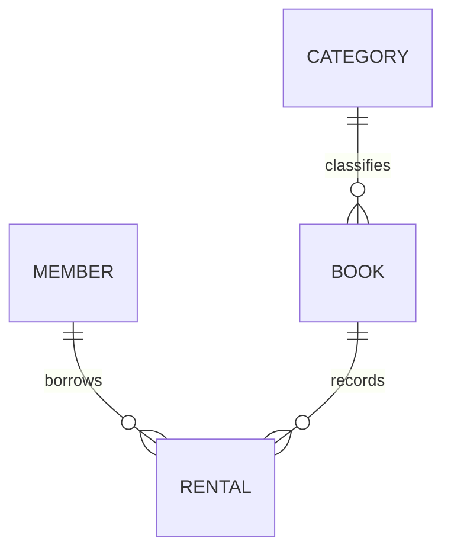

# Relational Database Lab

SQLite로 회원·도서·분류·대여 기록을 설계하고, SQL로 데이터를 조회·연결·집계하는 관계형 데이터베이스 실습 프로젝트입니다.

기본 정보와 반복되는 대여 이력을 분리하고, PK·FK·제약조건으로 데이터의 관계와 일관성을 관리합니다. 별도 서버나 백엔드 프레임워크 없이 SQL 파일만으로 실행할 수 있습니다.

## 기술 구성과 실행 환경

SQL 구현은 SQLite에서 실행하며, Python은 검증 도구에 사용합니다. 아래는 실제 검증한 환경입니다.

| 구성 요소 | 검증한 버전 | 용도 |
| --- | --- | --- |
| 운영체제 | macOS / Darwin 25.5.0 | 로컬 실행·검증 환경 |
| SQLite CLI | 3.51.0 | SQL 파일 직접 실행·CLI 검증 |
| Python | 3.12.15 | 검증 스크립트 실행 |
| Python 내장 SQLite | 3.53.4 | Python 검증 도구의 SQL 실행 |

SQL 파일 직접 실행에는 SQLite CLI가 필요합니다. Python 검증 도구는 Python 3.9 이상을 사용하며, 외부 Python 패키지를 설치하지 않습니다. 위 표의 버전은 최소 요구 버전이 아닌 실제 검증 버전입니다. SQLite의 최소 지원 버전과 다른 운영체제에서의 실행은 별도로 검증하지 않았습니다.

Python 내장 SQLite와 터미널의 SQLite CLI는 별도 실행 경로이므로 버전이 다를 수 있습니다. VS Code는 선택 가능한 편집 도구이며 실행에 필수는 아닙니다.

## 주요 기능

| 구분 | 내용 | 구현 위치 |
| --- | --- | --- |
| 필수 | 테이블 4개와 PK·FK·제약조건 | [schema.sql](schema.sql) |
| 필수 | 각 테이블에 10행 이상의 가상 데이터 입력 | [seed.sql](seed.sql) |
| 필수 | 기본 조회·조인·집계·서브쿼리·수정·삭제·인덱스 SQL 15개 | [queries.sql](queries.sql) |
| 필수 | 쿼리별 실행 SQL·결과 텍스트·스크린샷 | [results/](results/), [실행 캡처 15개](results/screenshots/README.md) |
| 보너스 | LEFT JOIN과 NOT EXISTS로 같은 문제 해결 | [bonus.sql](bonus.sql) |
| 보너스 | 제약조건 위반 입력과 거절 원인 기록 | [constraints.txt](results/constraints.txt) |
| 보너스 | 월별 대여 수·도서 인기 순위·회원별 연체료 집계 | [bonus.sql](bonus.sql), [결과](results/bonus.txt) |

초기 데이터는 회원 10·분류 10·책 12·대여 16행이며, 삭제 후 대여 15행입니다. 모든 데이터는 학습용 가상 데이터입니다.

## 프로젝트 구조

이 폴더가 저장소의 루트입니다. SQL과 제출용 실행 결과, 재현용 검증 도구를 포함합니다.

```text
relational-database-lab/
├── README.md
├── .gitignore
├── schema.sql              # 테이블과 제약조건
├── seed.sql                # 샘플 데이터
├── queries.sql             # 필수 SQL Q01~Q15
├── bonus.sql               # 추가 풀이와 지표
├── results/
│   ├── q01.txt … q15.txt    # 쿼리별 실행 결과
│   ├── constraints.txt     # 제약조건 위반 실험
│   ├── bonus.txt           # 보너스 실행 결과
│   ├── validation.md       # 검증 결과 요약
│   └── screenshots/        # Q01~Q15 실제 실행 화면과 캡처 안내
└── tools/
    ├── verify.py           # Python 내장 SQLite 검증
    └── verify_cli.py       # SQLite CLI 검증
```

핵심 구현은 SQL입니다. Python 도구는 새 데이터베이스에서 SQL을 실행하고 결과를 검증하는 보조 도구이며, 외부 패키지를 사용하지 않습니다.

## 데이터베이스 설계



| 테이블 | 한 행의 의미 | 주요 열 |
| --- | --- | --- |
| member | 회원 한 명 | id, name, email, joined_at |
| category | 도서 분류 하나 | id, name |
| book | 실제 대여 가능한 책 한 권 | id, title, category_id |
| rental | 한 번의 대여 기록 | id, member_id, book_id, borrowed_at, returned_at, late_fee |

### 테이블을 분리한 이유

한 표에 회원 이름·이메일·책 제목까지 저장하면 대여할 때마다 같은 정보가 반복됩니다. 회원 정보를 바꿀 때 일부 행만 수정하면 값이 서로 달라질 수 있습니다. 기본 정보는 회원·책·분류 표에 두고, 대여 표에는 연결 번호와 대여 정보를 저장해 중복과 수정 누락을 줄였습니다.

회원 한 명은 여러 대여 기록을 가질 수 있고, 책 한 권도 시기를 달리해 여러 번 대여될 수 있습니다. 분류 하나에는 여러 책이 속합니다. 세 관계 모두 1:N이며 FK로 연결합니다.

각 표의 `id`는 해당 행의 PK입니다. `rental.id`는 대여번호이고, `rental.member_id`와 `rental.book_id`는 각각 회원과 책을 참조하는 FK입니다.

### 자료형과 제약조건

- 식별자와 원 단위 연체료는 `INTEGER`, 이름·제목·이메일은 `TEXT`를 사용합니다.
- 날짜는 SQLite에 날짜 전용 저장 자료형이 없어 `YYYY-MM-DD` 형식의 `TEXT`로 통일했습니다. 미반납 기록의 `returned_at`은 `NULL`입니다.
- `NOT NULL`로 필수값을 지정하고, `UNIQUE`로 회원 이메일과 분류명의 중복을 막습니다.
- `CHECK`로 음수 연체료와 대여일보다 앞선 반납일을 막습니다.
- 연결마다 `PRAGMA foreign_keys = ON;`을 실행해 없는 회원·책·분류 참조를 거절합니다.
- 참조되는 회원·책의 삭제는 기본 `NO ACTION` 정책으로 막아 대여 이력을 보호합니다.

### 선택한 방식과 대안

SQLite는 별도 서버 없이 로컬에서 재현하기 쉬워 선택했습니다. 서버 운영과 다중 사용자 환경까지 다루려면 PostgreSQL이나 MySQL로 확장할 수 있습니다.

테이블 분리는 중복을 줄이는 대신 함께 조회할 때 JOIN이 필요합니다. 관련 정보를 함께 표시할 때는 JOIN, 대여 이력의 존재 여부만 확인할 때는 EXISTS를 사용했습니다.

회원별 대여 검색과 조인에 사용하는 `rental.member_id`에 인덱스를 만들었습니다. 인덱스는 저장 공간과 쓰기 비용이 추가되므로 필요한 열에만 적용했습니다. 실행 계획에서 사용을 확인했으며, 속도 향상을 측정한 것은 아닙니다.

## 실행 방법

### 환경 확인

VS Code에서는 `relational-database-lab` 폴더를 열고 터미널을 사용합니다. 아래 명령은 프로젝트의 상위 폴더에서 시작하는 예시입니다. 이미 프로젝트 폴더 안이라면 `cd`는 생략합니다.

```bash
cd relational-database-lab
sqlite3 --version
python3 --version
python3 -c "import sqlite3; print(sqlite3.sqlite_version)"
```

### SQL 직접 실행

아직 존재하지 않는 새 DB 파일명으로 시작합니다.

```bash
sqlite3 practice.db
```

SQLite 안에서 다음 순서로 실행합니다.

```sql
.bail on
.headers on
.mode column
.read schema.sql
.read seed.sql
.read queries.sql
.read bonus.sql
.quit
```

`schema.sql → seed.sql → queries.sql → bonus.sql` 순서입니다. `bonus.sql`은 필수 쿼리 실행 후 상태를 기준으로 합니다. `.read` 등의 점 명령은 SQLite CLI 전용 명령이며, SQL 자체의 문법은 아닙니다.

`queries.sql`은 조회뿐 아니라 103번 대여의 반납일 수정, 116번 대여 삭제, 인덱스 생성을 수행합니다. 실행 후 대여는 15행이며, 103번 반납일은 `2026-10-10`입니다.

스키마와 샘플 데이터는 새 DB에서 한 번 실행하도록 작성했습니다. 다시 실습하려면 `practice2.db`처럼 새 파일명을 사용하세요. 기존 DB에 반복 실행하면 테이블 존재 또는 PK 중복 오류가 발생할 수 있습니다.

### 검증 도구 실행

```bash
python3 tools/verify.py
python3 tools/verify_cli.py
```

- `verify.py`의 `main`은 새 메모리 DB에서 42개 검사를 수행하고 결과 파일을 생성합니다. `show`는 조회 결과를 텍스트로 변환합니다.
- `verify_cli.py`의 `main`은 임시 파일 DB에서 12개 검사를 수행합니다. `run_cli`는 설치된 SQLite CLI를 실행합니다.

두 도구는 기존 사용자 DB를 변경하지 않습니다. 실행하면 `results`의 쿼리 결과와 검증 로그가 갱신됩니다. 환경별 원시 검증 로그는 Git 추적에서 제외합니다. 도구 실행에 실패하면 오류와 비정상 종료 코드로 표시합니다.

## SQL 목록과 실행 결과

| 번호 | 기능 | 확인 내용 | 결과 |
| --- | --- | --- | --- |
| Q01 | 기본 조회 | 회원 전체 조회 | [텍스트](results/q01.txt) · [스크린샷](results/screenshots/q01.png) |
| Q02 | WHERE | 1번 분류의 책 검색 | [텍스트](results/q02.txt) · [스크린샷](results/screenshots/q02.png) |
| Q03 | ORDER BY | 최근 가입한 회원부터 정렬 | [텍스트](results/q03.txt) · [스크린샷](results/screenshots/q03.png) |
| Q04 | LIMIT | 최근 대여 5건 조회 | [텍스트](results/q04.txt) · [스크린샷](results/screenshots/q04.png) |
| Q05 | INNER JOIN | 대여 기록에 회원 이름 연결 | [텍스트](results/q05.txt) · [스크린샷](results/screenshots/q05.png) |
| Q06 | INNER JOIN | 책에 분류명 연결 | [텍스트](results/q06.txt) · [스크린샷](results/screenshots/q06.png) |
| Q07 | LEFT JOIN | 대여하지 않은 회원도 포함 | [텍스트](results/q07.txt) · [스크린샷](results/screenshots/q07.png) |
| Q08 | 다중 JOIN | 회원·대여·책 연결 | [텍스트](results/q08.txt) · [스크린샷](results/screenshots/q08.png) |
| Q09 | COUNT·GROUP BY | 회원별 대여 건수 | [텍스트](results/q09.txt) · [스크린샷](results/screenshots/q09.png) |
| Q10 | SUM·GROUP BY | 회원별 연체료 합계 | [텍스트](results/q10.txt) · [스크린샷](results/screenshots/q10.png) |
| Q11 | AVG·GROUP BY | 반납 완료 기록의 회원별 평균 대여일수 | [텍스트](results/q11.txt) · [스크린샷](results/screenshots/q11.png) |
| Q12 | 서브쿼리 | 대여 이력이 없는 회원 검색 | [텍스트](results/q12.txt) · [스크린샷](results/screenshots/q12.png) |
| Q13 | UPDATE | 103번 대여 반납 처리 | [텍스트](results/q13.txt) · [스크린샷](results/screenshots/q13.png) |
| Q14 | DELETE | 116번 대여 기록 삭제 | [텍스트](results/q14.txt) · [스크린샷](results/screenshots/q14.png) |
| Q15 | CREATE INDEX | 회원번호 검색용 인덱스 생성 | [텍스트](results/q15.txt) · [스크린샷](results/screenshots/q15.png) |

### 실행 결과 스크린샷

Q01~Q15를 SQLite Fiddle의 새 임시 DB에서 순서대로 실행한 화면을 `results/screenshots/`에 첨부했습니다. 각 이미지에는 SQL 입력과 실제 출력이 함께 보입니다. Q13·Q14는 변경 전후를, Q15는 생성된 인덱스와 실행 계획을 포함합니다.

캡처 환경은 SQLite Fiddle(WebAssembly) 3.55.0이며, 앞서 기록한 로컬 Python·CLI 검증 환경과 구분합니다. [전체 스크린샷과 재현 안내](results/screenshots/README.md)에서 쿼리별 이미지와 실행 내용을 확인할 수 있습니다.


### 복잡 쿼리 단계별 해설: Q09 회원별 대여 건수

목표는 **대여하지 않은 회원도 포함해 모든 회원의 대여 횟수를 구하는 것**입니다. 아래는 `queries.sql`의 Q09를 읽기 좋게 줄바꿈한 SQL입니다.

```sql
SELECT m.id, m.name, COUNT(r.id) AS rental_count
FROM member AS m
LEFT JOIN rental AS r ON m.id = r.member_id
GROUP BY m.id, m.name
ORDER BY rental_count DESC, m.id;
```

아래 순서는 SQL의 논리적 처리 과정을 설명합니다. SQLite가 실제로 중간 테이블을 모두 생성한다는 뜻은 아니며, 물리적 실행 방법은 실행 계획에 따라 달라질 수 있습니다. 행 수는 Q13 수정·Q14 삭제 이전의 샘플 데이터 기준입니다.

| 단계 | SQL과 처리 이유 | 입력 행셋 | 출력 행셋 |
| --- | --- | --- | --- |
| 1. 기준 선택 | `FROM member AS m`: 미대여 회원도 포함해야 하므로 회원 표를 기준으로 선택 | member 10행 | 회원번호·이름을 가진 회원 10행 |
| 2. 대여 연결 | `LEFT JOIN rental AS r ON m.id = r.member_id`: 회원번호가 같은 대여를 연결하고 대여 없는 회원도 유지 | 회원 10행 + 대여 16행 | 대여가 있는 회원의 16행 + 미대여 회원 2행 = 18행 |
| 3. 회원별 집계 | `GROUP BY m.id, m.name`과 `COUNT(r.id)`: 회원별로 묶고 NULL이 아닌 대여번호만 계산 | 연결 결과 18행 | 회원별 요약 10행. 회원 1~8은 각 2건, 회원 9·10은 각 0건 |
| 4. 정렬 | `ORDER BY rental_count DESC, m.id`: 건수가 많은 순서, 동률이면 회원번호 오름차순 | 집계 결과 10행 | 같은 10행을 정렬. 회원 1~8 다음에 9·10 표시 |

2단계에서 1·9·10번 회원만 발췌하면 다음과 같습니다. `m.id`는 회원번호이고, `r.id`는 대여번호입니다.

| m.id | m.name | r.id |
| --- | --- | --- |
| 1 | 회원01 | 101 |
| 1 | 회원01 | 109 |
| 9 | 회원09 | NULL |
| 10 | 회원10 | NULL |

3단계는 위 행들을 회원별로 요약합니다.

| id | name | rental_count | 계산 이유 |
| --- | --- | --- | --- |
| 1 | 회원01 | 2 | 대여번호 101·109 두 개를 계산 |
| 9 | 회원09 | 0 | NULL은 COUNT(r.id)에서 제외 |
| 10 | 회원10 | 0 | NULL은 COUNT(r.id)에서 제외 |

`COUNT(*)`를 쓰면 LEFT JOIN이 남긴 미대여 회원의 한 행도 세어 1건이 됩니다. 그래서 대여 자체의 PK인 `r.id`를 셉니다. 이름이 같은 회원을 합치지 않도록 GROUP BY에는 회원번호도 포함합니다. Q09에서는 실제 회원 모두 2건 또는 0건이므로 같은 건수 안에서 회원번호 순서가 적용됩니다.

검증 시 새 메모리 DB에서 기준 조회·LEFT JOIN·회원별 집계·원본 Q09를 각각 실행해 10 → 18 → 10 → 10행을 확인했습니다. 최종 10행의 전체 값은 [기존 Q09 결과](results/q09.txt)와 일치합니다. [Q09 실행 스크린샷](results/screenshots/q09.png)에서도 최종 결과를 확인할 수 있습니다.

### 서브쿼리 단계별 해설: Q12 미대여 회원

```sql
SELECT m.id, m.name
FROM member AS m
WHERE NOT EXISTS (
    SELECT 1
    FROM rental AS r
    WHERE r.member_id = m.id
)
ORDER BY m.id;
```

| 단계 | 입력과 판단 | 출력 행셋 요약 |
| --- | --- | --- |
| 1. 회원 선택 | 바깥 `FROM member AS m`에서 회원 10명을 대상으로 판단 | 후보 회원 10행 |
| 2. 연결 대여 존재 확인 | 각 회원의 `m.id`와 같은 `r.member_id`가 있는지 서브쿼리로 확인 | 회원 1~8은 존재, 회원 9·10은 존재하지 않음 |
| 3. NOT EXISTS 적용 | 연결 대여가 존재하지 않는 회원만 남김 | 회원 9·10 두 행 |
| 4. 정렬·출력 | 회원번호 오름차순으로 id와 name 표시 | `(9, 회원09)`, `(10, 회원10)` 순서의 2행 |

1번 회원으로 판단하면 대여번호 101·109가 연결되므로 EXISTS가 참이고 NOT EXISTS는 거짓이라 제외됩니다. 9번 회원은 연결되는 대여가 없으므로 NOT EXISTS가 참이라 남습니다. `SELECT 1`은 존재 확인용 상수이며 회원번호 1을 검색한다는 의미가 아닙니다. 이 설명도 논리적 판단 과정이며 SQLite가 반드시 회원마다 서브쿼리를 독립 실행한다는 주장은 아닙니다.

새 메모리 DB에서 회원별 EXISTS 판단 10행과 원본 Q12의 최종 2행을 확인했습니다. 최종 값은 [기존 Q12 결과](results/q12.txt)와 일치합니다.

Q09~Q11은 Q13·Q14의 수정·삭제 이전 결과입니다. 보너스 집계는 수정·삭제 이후 결과이므로 비교할 때 실행 시점을 구분해야 합니다.

## 검증 결과

macOS에서 실행한 검증 기록을 기준으로 합니다.

| 검증 | 결과 | 확인 범위 |
| --- | --- | --- |
| Python 내장 SQLite | 42개 통과 | 스키마·제약조건·쿼리 결과·대상 외 데이터 보존 |
| SQLite CLI | 12개 통과 | SQL 파일 순서 실행·FK 거절과 수정·DB 무결성·인덱스 사용 |

두 경로에 중복 검사가 있으므로 통과 개수를 독립 테스트 수로 합산하지 않습니다. 사용한 버전은 상단의 기술 구성과 실행 환경에 정리했습니다.

검증 대상과 실제 확인값은 [검증 결과 요약](results/validation.md)에 정리했습니다.

## 기술적 한계

- FK는 참조 대상의 존재를 검사합니다. 같은 책의 동시 대여나 기간 겹침은 자동으로 막지 않습니다.
- 날짜 CHECK는 문자열 비교이며 모든 잘못된 날짜 형식을 차단하지 않습니다. 고정 샘플의 날짜 파싱은 검증 도구에서 확인했습니다.
- `NOT NULL`은 빈 문자열이나 공백 입력까지 막지는 않습니다.
- 책 한 행은 실제 책 한 권입니다. 서지정보와 복사본을 별도 테이블로 분리하지 않았습니다.
- 연체료는 저장된 가상 값입니다. 자동 계산 정책은 구현하지 않았습니다.
- 데스크톱 DB 관리 도구, 대규모 성능, 여러 사용자 동시 실행은 검증하지 않았습니다.
- 뷰·프로시저·트리거와 백엔드 프레임워크는 사용하지 않았습니다.
