# SQL 실행 결과 스크린샷

필수 쿼리 Q01~Q15의 실제 실행 화면 15개입니다. 각 PNG는 SQLite Fiddle 화면을 직접 캡처했습니다.

## 캡처 환경과 실행 순서

- 실행 도구: [SQLite Fiddle](https://sqlite.org/fiddle/) (SQLite CLI의 WebAssembly 빌드)
- SQLite 버전: 3.55.0
- 초기 상태: 새 임시 DB에 프로젝트의 schema.sql → seed.sql 입력
- 실행 순서: queries.sql의 Q01 → Q15. 조회·집계는 수정·삭제 이전 상태입니다.
- Q13·Q14는 전후 확인용 SELECT, Q15는 생성 확인과 EXPLAIN QUERY PLAN을 추가했습니다.
- .headers·.mode·.separator·.nullvalue는 표시 설정이고 .print는 구간 표시입니다. 원본 SQL의 동작은 변경하지 않았습니다.
- 왼쪽은 입력, 오른쪽은 실제 실행 결과입니다. END Q번호는 해당 실행의 출력 종료 표시입니다.

로컬 Mac의 SQLite CLI 3.51.0 및 Python 내장 SQLite 3.53.4 검증 기록과는 별도의 캡처 환경입니다. Q01~Q12는 기존 텍스트 결과의 전체 열·행과 일치함을 대조했습니다. 실행 계획의 표시 형식은 SQLite 버전에 따라 다를 수 있습니다.

## 재현 방법

SQLite Fiddle을 열고 필요하면 Toggle view로 입력·출력 분할 화면을 선택합니다. schema.sql과 seed.sql의 내용을 순서대로 입력해 Run을 누릅니다. 이후 아래 SQL을 Q01부터 순서대로 실행합니다. 결과를 비교할 때는 Clear Output 또는 Auto-clear output으로 이전 출력을 구분합니다. 개인 DB 파일은 사용하지 않습니다.

## Q01 — 기본 조회: 회원 전체를 식별자 순서로 확인한다.

[기존 결과 텍스트](../q01.txt)

```sql
.headers on
.mode list
.separator " | "
.nullvalue NULL
-- Q01 | 기본 조회: 회원 전체를 식별자 순서로 확인한다.
SELECT id, name, email FROM member ORDER BY id;
.print END Q01
```

실제 실행 출력:

```text
id | name | email
1 | 회원01 | member01@example.test
2 | 회원02 | member02@example.test
3 | 회원03 | member03@example.test
4 | 회원04 | member04@example.test
5 | 회원05 | member05@example.test
6 | 회원06 | member06@example.test
7 | 회원07 | member07@example.test
8 | 회원08 | member08@example.test
9 | 회원09 | member09@example.test
10 | 회원10 | member10@example.test
```

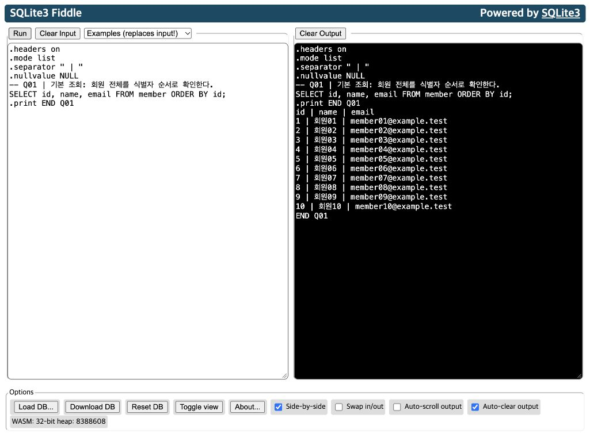

## Q02 — 기본 조회: 1번 분류의 책을 검색한다.

[기존 결과 텍스트](../q02.txt)

```sql
.headers on
.mode list
.separator " | "
.nullvalue NULL
-- Q02 | 기본 조회: 1번 분류의 책을 검색한다.
SELECT id, title FROM book WHERE category_id = 1 ORDER BY id;
.print END Q02
```

실제 실행 출력:

```text
id | title
1 | 학습 도서 01
11 | 학습 도서 11
```

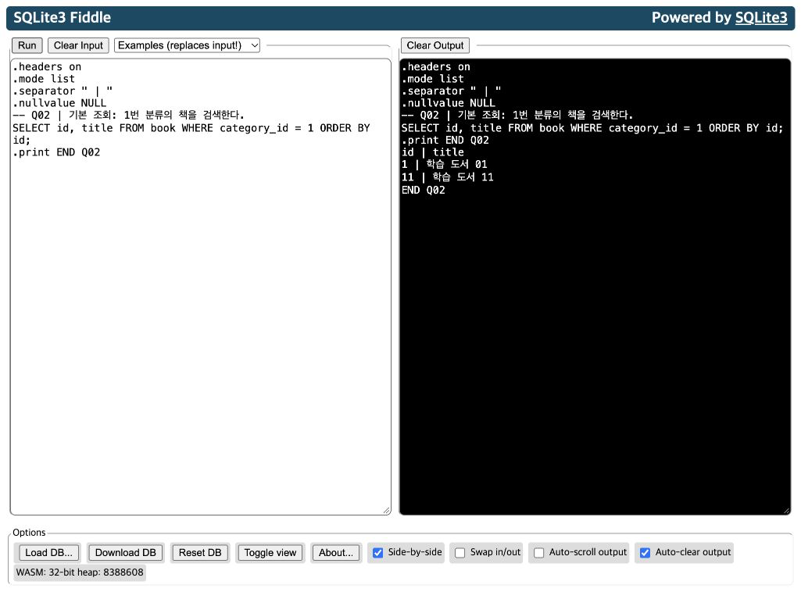

## Q03 — 기본 조회: 가입일 최신순으로 회원을 조회한다.

[기존 결과 텍스트](../q03.txt)

```sql
.headers on
.mode list
.separator " | "
.nullvalue NULL
-- Q03 | 기본 조회: 가입일 최신순으로 회원을 조회한다.
SELECT id, name, joined_at FROM member ORDER BY joined_at DESC, id DESC;
.print END Q03
```

실제 실행 출력:

```text
id | name | joined_at
10 | 회원10 | 2026-09-10
9 | 회원09 | 2026-09-09
8 | 회원08 | 2026-09-08
7 | 회원07 | 2026-09-07
6 | 회원06 | 2026-09-06
5 | 회원05 | 2026-09-05
4 | 회원04 | 2026-09-04
3 | 회원03 | 2026-09-03
2 | 회원02 | 2026-09-02
1 | 회원01 | 2026-09-01
```

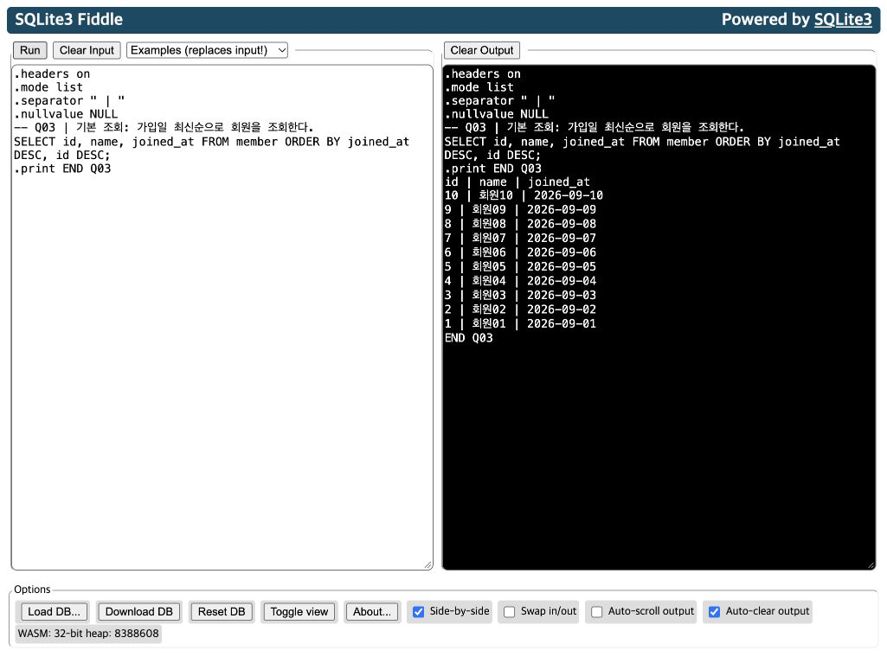

## Q04 — 기본 조회: 최근 대여 5건만 조회한다. LIMIT는 선택한 SQLite에서 지원하는 문법이다.

[기존 결과 텍스트](../q04.txt)

```sql
.headers on
.mode list
.separator " | "
.nullvalue NULL
-- Q04 | 기본 조회: 최근 대여 5건만 조회한다. LIMIT는 선택한 SQLite에서 지원하는 문법이다.
SELECT id, borrowed_at FROM rental ORDER BY borrowed_at DESC, id DESC LIMIT 5;
.print END Q04
```

실제 실행 출력:

```text
id | borrowed_at
116 | 2026-10-16
115 | 2026-10-15
114 | 2026-10-14
113 | 2026-10-13
112 | 2026-10-12
```

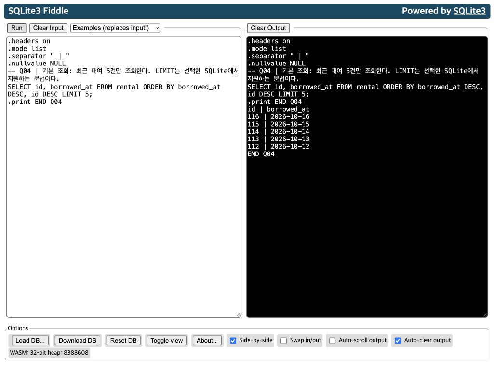

## Q05 — INNER JOIN: 회원번호가 일치하는 대여와 회원 이름을 연결한다.

[기존 결과 텍스트](../q05.txt)

```sql
.headers on
.mode list
.separator " | "
.nullvalue NULL
-- Q05 | INNER JOIN: 회원번호가 일치하는 대여와 회원 이름을 연결한다.
SELECT m.name, r.id AS rental_id FROM member AS m INNER JOIN rental AS r ON m.id = r.member_id ORDER BY r.id;
.print END Q05
```

실제 실행 출력:

```text
name | rental_id
회원01 | 101
회원02 | 102
회원03 | 103
회원04 | 104
회원05 | 105
회원06 | 106
회원07 | 107
회원08 | 108
회원01 | 109
회원02 | 110
회원03 | 111
회원04 | 112
회원05 | 113
회원06 | 114
회원07 | 115
회원08 | 116
```

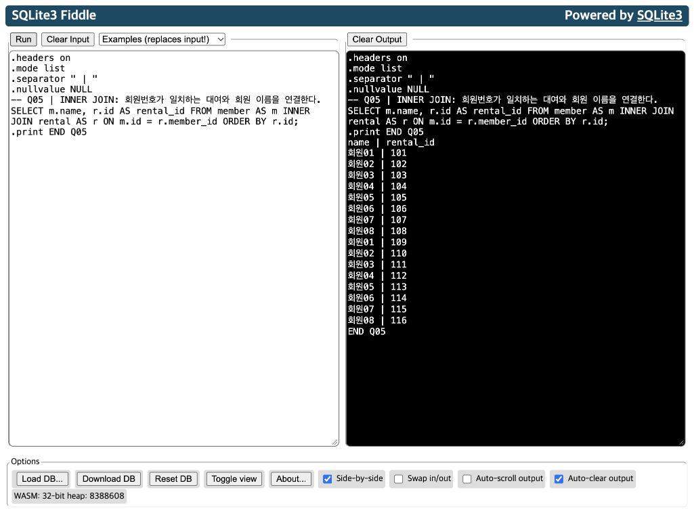

## Q06 — INNER JOIN: 책의 분류명을 연결한다.

[기존 결과 텍스트](../q06.txt)

```sql
.headers on
.mode list
.separator " | "
.nullvalue NULL
-- Q06 | INNER JOIN: 책의 분류명을 연결한다.
SELECT b.id, b.title, c.name AS category_name FROM book AS b INNER JOIN category AS c ON b.category_id = c.id ORDER BY b.id;
.print END Q06
```

실제 실행 출력:

```text
id | title | category_name
1 | 학습 도서 01 | 분류01
2 | 학습 도서 02 | 분류02
3 | 학습 도서 03 | 분류03
4 | 학습 도서 04 | 분류04
5 | 학습 도서 05 | 분류05
6 | 학습 도서 06 | 분류06
7 | 학습 도서 07 | 분류07
8 | 학습 도서 08 | 분류08
9 | 학습 도서 09 | 분류09
10 | 학습 도서 10 | 분류10
11 | 학습 도서 11 | 분류01
12 | 학습 도서 12 | 분류02
```

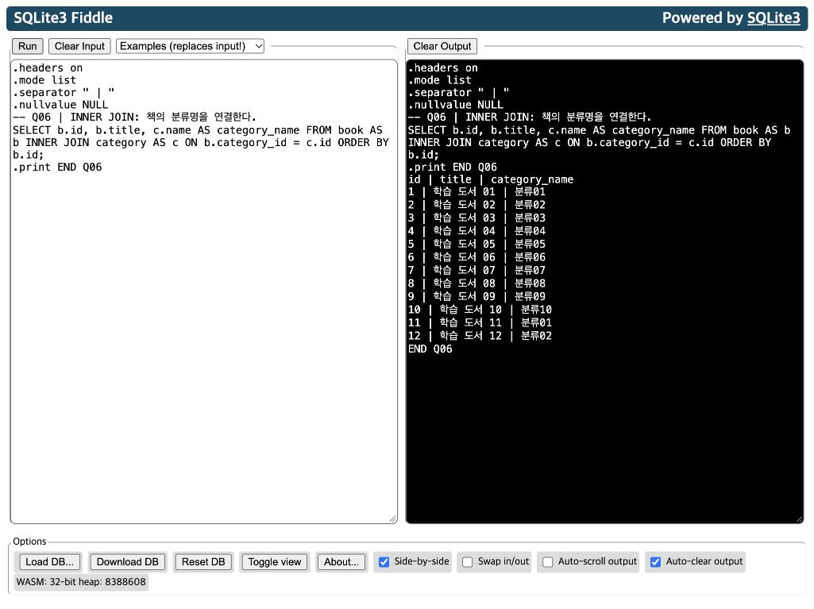

## Q07 — ★ 평가 핵심 Q07 LEFT JOIN: 미대여 회원도 남긴다. NULL은 연결된 대여가 없다는 뜻이다.

[기존 결과 텍스트](../q07.txt)

```sql
.headers on
.mode list
.separator " | "
.nullvalue NULL
-- Q07 | ★ 평가 핵심 Q07 LEFT JOIN: 미대여 회원도 남긴다. NULL은 연결된 대여가 없다는 뜻이다.
SELECT m.id, m.name, r.id AS rental_id FROM member AS m LEFT JOIN rental AS r ON m.id = r.member_id ORDER BY m.id, r.id;
.print END Q07
```

실제 실행 출력:

```text
id | name | rental_id
1 | 회원01 | 101
1 | 회원01 | 109
2 | 회원02 | 102
2 | 회원02 | 110
3 | 회원03 | 103
3 | 회원03 | 111
4 | 회원04 | 104
4 | 회원04 | 112
5 | 회원05 | 105
5 | 회원05 | 113
6 | 회원06 | 106
6 | 회원06 | 114
7 | 회원07 | 107
7 | 회원07 | 115
8 | 회원08 | 108
8 | 회원08 | 116
9 | 회원09 | NULL
10 | 회원10 | NULL
```

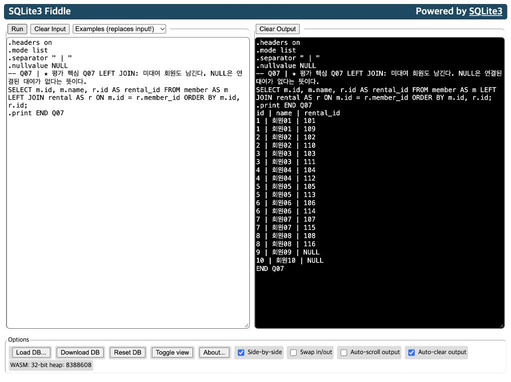

## Q08 — 조인: 회원·대여·책을 연결해 누가 무엇을 빌렸는지 확인한다.

[기존 결과 텍스트](../q08.txt)

```sql
.headers on
.mode list
.separator " | "
.nullvalue NULL
-- Q08 | 조인: 회원·대여·책을 연결해 누가 무엇을 빌렸는지 확인한다.
SELECT r.id, m.name, b.title, r.borrowed_at FROM rental AS r INNER JOIN member AS m ON r.member_id = m.id INNER JOIN book AS b ON r.book_id = b.id ORDER BY r.id;
.print END Q08
```

실제 실행 출력:

```text
id | name | title | borrowed_at
101 | 회원01 | 학습 도서 01 | 2026-10-01
102 | 회원02 | 학습 도서 02 | 2026-10-02
103 | 회원03 | 학습 도서 03 | 2026-10-03
104 | 회원04 | 학습 도서 04 | 2026-10-04
105 | 회원05 | 학습 도서 05 | 2026-10-05
106 | 회원06 | 학습 도서 06 | 2026-10-06
107 | 회원07 | 학습 도서 07 | 2026-10-07
108 | 회원08 | 학습 도서 08 | 2026-10-08
109 | 회원01 | 학습 도서 09 | 2026-10-09
110 | 회원02 | 학습 도서 10 | 2026-10-10
111 | 회원03 | 학습 도서 11 | 2026-10-11
112 | 회원04 | 학습 도서 12 | 2026-10-12
113 | 회원05 | 학습 도서 01 | 2026-10-13
114 | 회원06 | 학습 도서 02 | 2026-10-14
115 | 회원07 | 학습 도서 03 | 2026-10-15
116 | 회원08 | 학습 도서 04 | 2026-10-16
```

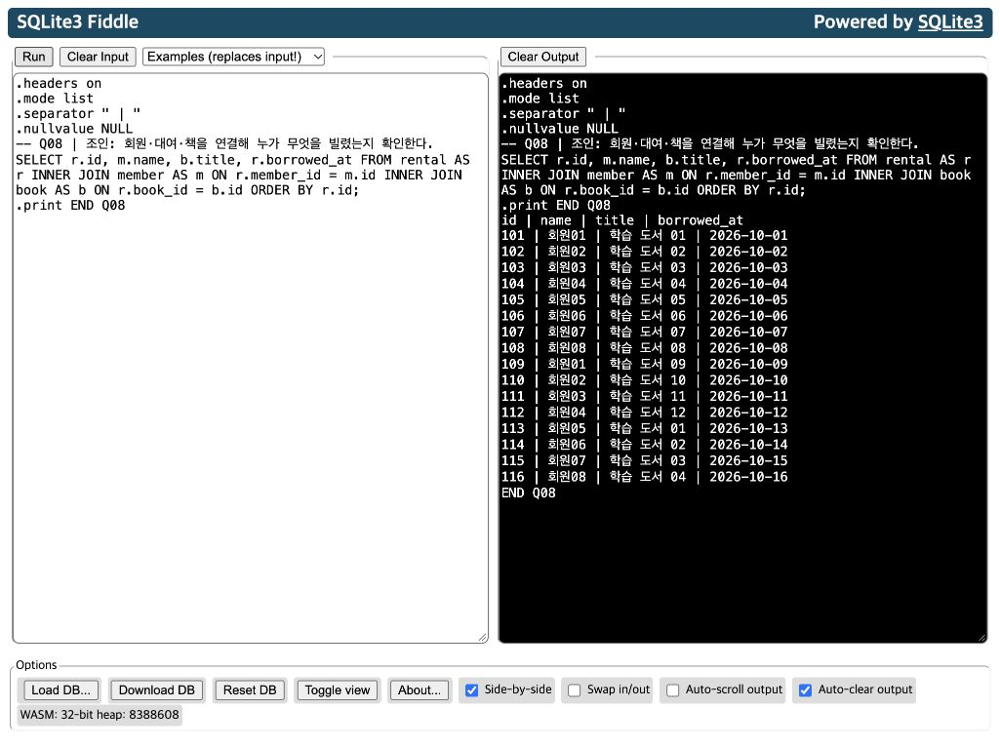

## Q09 — ★ 평가 핵심 Q09 집계: 회원별 대여 건수. COUNT(r.id)는 NULL을 제외해 미대여 회원을 0으로 센다.

[기존 결과 텍스트](../q09.txt)

```sql
.headers on
.mode list
.separator " | "
.nullvalue NULL
-- Q09 | ★ 평가 핵심 Q09 집계: 회원별 대여 건수. COUNT(r.id)는 NULL을 제외해 미대여 회원을 0으로 센다.
SELECT m.id, m.name, COUNT(r.id) AS rental_count FROM member AS m LEFT JOIN rental AS r ON m.id = r.member_id GROUP BY m.id, m.name ORDER BY rental_count DESC, m.id;
.print END Q09
```

실제 실행 출력:

```text
id | name | rental_count
1 | 회원01 | 2
2 | 회원02 | 2
3 | 회원03 | 2
4 | 회원04 | 2
5 | 회원05 | 2
6 | 회원06 | 2
7 | 회원07 | 2
8 | 회원08 | 2
9 | 회원09 | 0
10 | 회원10 | 0
```

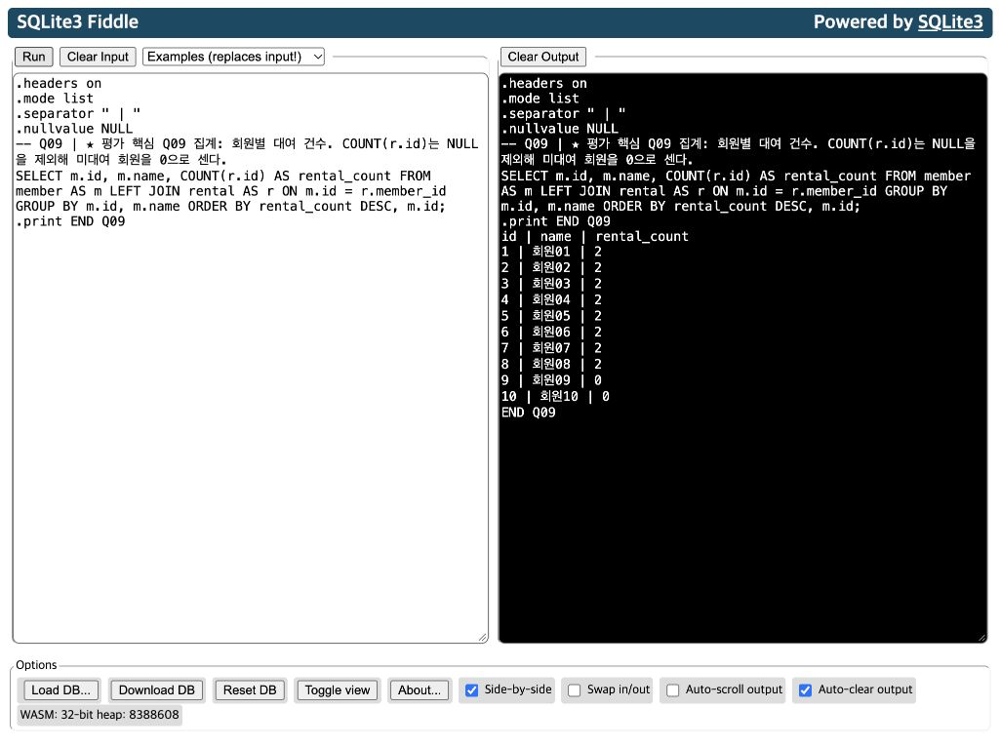

## Q10 — 집계: 회원별 연체료 합계. COALESCE는 대여가 없어 합계가 NULL인 경우 0으로 표시한다.

[기존 결과 텍스트](../q10.txt)

```sql
.headers on
.mode list
.separator " | "
.nullvalue NULL
-- Q10 | 집계: 회원별 연체료 합계. COALESCE는 대여가 없어 합계가 NULL인 경우 0으로 표시한다.
SELECT m.id, m.name, COALESCE(SUM(r.late_fee), 0) AS total_fee FROM member AS m LEFT JOIN rental AS r ON m.id = r.member_id GROUP BY m.id, m.name ORDER BY m.id;
.print END Q10
```

실제 실행 출력:

```text
id | name | total_fee
1 | 회원01 | 500
2 | 회원02 | 1500
3 | 회원03 | 1000
4 | 회원04 | 500
5 | 회원05 | 1500
6 | 회원06 | 1000
7 | 회원07 | 500
8 | 회원08 | 1500
9 | 회원09 | 0
10 | 회원10 | 0
```

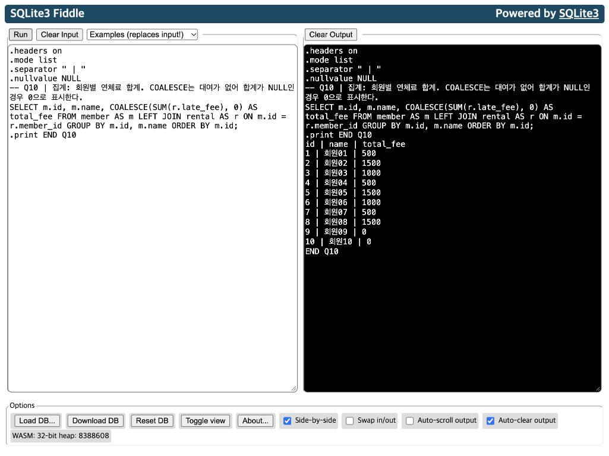

## Q11 — 집계: 반납 완료 기록의 회원별 평균 대여일수. julianday는 SQLite 날짜 함수다.

[기존 결과 텍스트](../q11.txt)

```sql
.headers on
.mode list
.separator " | "
.nullvalue NULL
-- Q11 | 집계: 반납 완료 기록의 회원별 평균 대여일수. julianday는 SQLite 날짜 함수다.
SELECT member_id, AVG(julianday(returned_at) - julianday(borrowed_at)) AS avg_days FROM rental WHERE returned_at IS NOT NULL GROUP BY member_id ORDER BY member_id;
.print END Q11
```

실제 실행 출력:

```text
member_id | avg_days
1 | 3.0
2 | 3.0
3 | 3.0
4 | 3.0
5 | 3.0
6 | 3.0
7 | 3.0
8 | 3.0
```

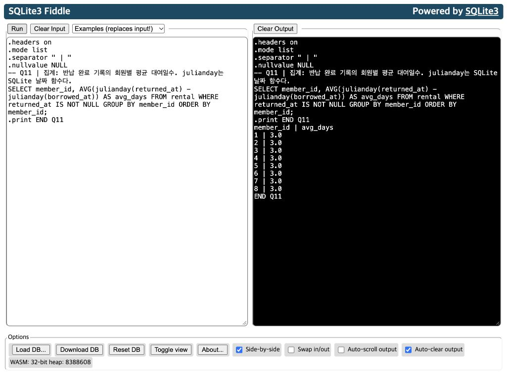

## Q12 — ★ 평가 핵심 Q12 서브쿼리: 대여 이력이 전혀 없는 회원을 찾는다. SELECT 1은 존재 확인용이다.

[기존 결과 텍스트](../q12.txt)

```sql
.headers on
.mode list
.separator " | "
.nullvalue NULL
-- Q12 | ★ 평가 핵심 Q12 서브쿼리: 대여 이력이 전혀 없는 회원을 찾는다. SELECT 1은 존재 확인용이다.
SELECT m.id, m.name FROM member AS m WHERE NOT EXISTS (SELECT 1 FROM rental AS r WHERE r.member_id = m.id) ORDER BY m.id;
.print END Q12
```

실제 실행 출력:

```text
id | name
9 | 회원09
10 | 회원10
```

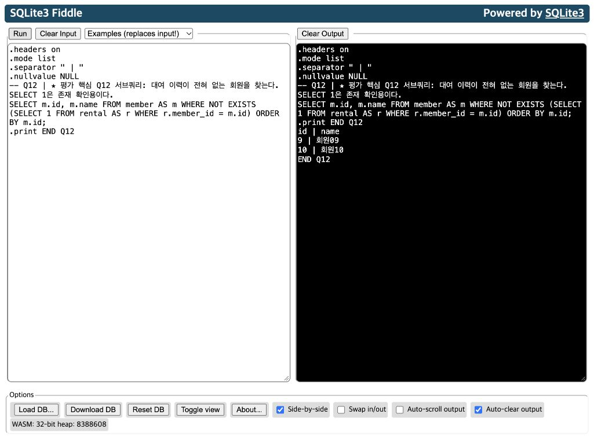

## Q13 — ★ 평가 핵심 Q13 수정: 103번 대여를 반납 처리한다. WHERE로 대상 하나를 지정한다.

[기존 결과 텍스트](../q13.txt)

```sql
.headers on
.mode list
.separator " | "
.nullvalue NULL
-- Q13
.print BEFORE
SELECT id, returned_at FROM rental WHERE id=103;
UPDATE rental SET returned_at = '2026-10-10' WHERE id = 103;
.print AFTER
SELECT id, returned_at FROM rental WHERE id=103;
.print END Q13
```

실제 실행 출력:

```text
BEFORE
id | returned_at
103 | NULL
AFTER
id | returned_at
103 | 2026-10-10
```

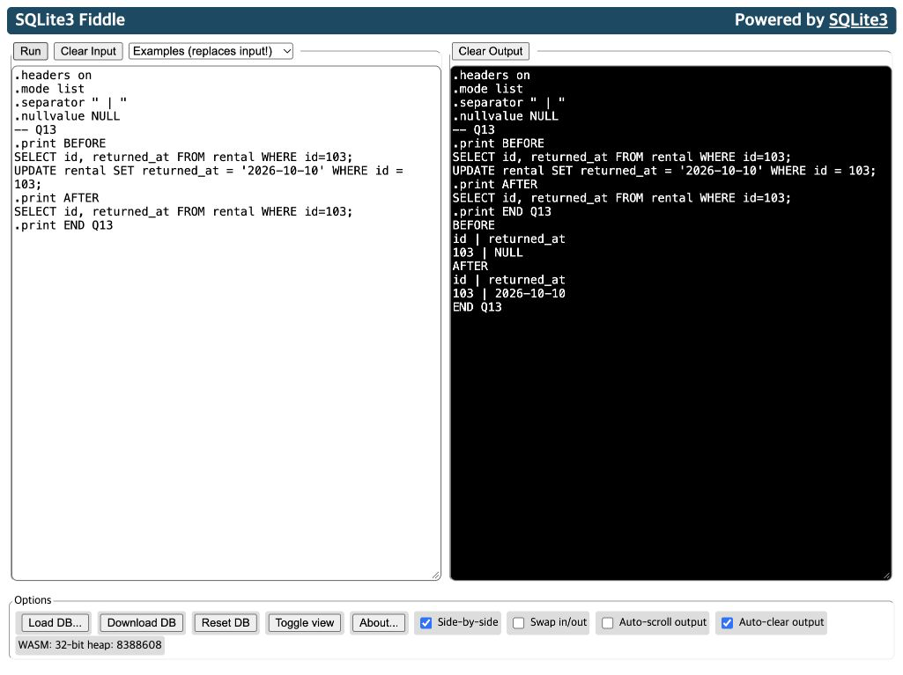

## Q14 — ★ 평가 핵심 Q14 삭제: 지정한 가상 대여 기록만 삭제한다. 표 자체는 유지된다.

[기존 결과 텍스트](../q14.txt)

```sql
.headers on
.mode list
.separator " | "
.nullvalue NULL
-- Q14
.print BEFORE
SELECT id, member_id, book_id FROM rental WHERE id=116;
DELETE FROM rental WHERE id = 116;
.print AFTER
SELECT COUNT(*) AS target_rows FROM rental WHERE id=116;
SELECT COUNT(*) AS rental_rows FROM rental;
.print END Q14
```

실제 실행 출력:

```text
BEFORE
id | member_id | book_id
116 | 8 | 4
AFTER
target_rows
0
rental_rows
15
```

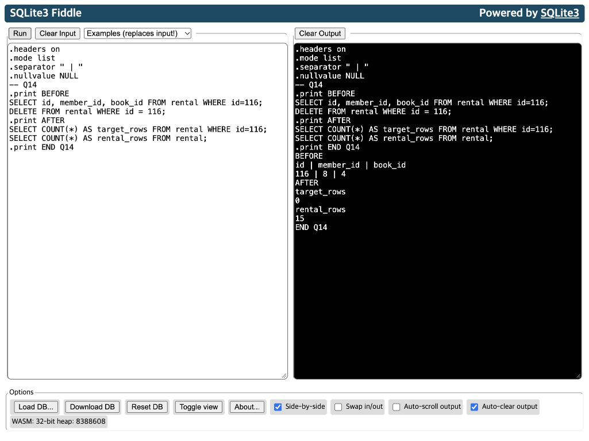

## Q15 — ★ 평가 핵심 Q15 인덱스: 회원별 대여 검색과 조인에 사용하는 member_id를 대상으로 한다. 쓰기 비용·공간이 추가되며 속도 향상을 단정하지 않는다.

[기존 결과 텍스트](../q15.txt)

```sql
.headers on
.mode list
.separator " | "
.nullvalue NULL
-- Q15
CREATE INDEX idx_rental_member_id ON rental(member_id);
SELECT name, sql FROM sqlite_master WHERE name='idx_rental_member_id';
EXPLAIN QUERY PLAN SELECT * FROM rental WHERE member_id=1;
.print END Q15
```

실제 실행 출력:

```text
name | sql
idx_rental_member_id | CREATE INDEX idx_rental_member_id ON rental(member_id)
QUERY PLAN
`--SEARCH rental USING INDEX idx_rental_member_id (member_id=?)
```

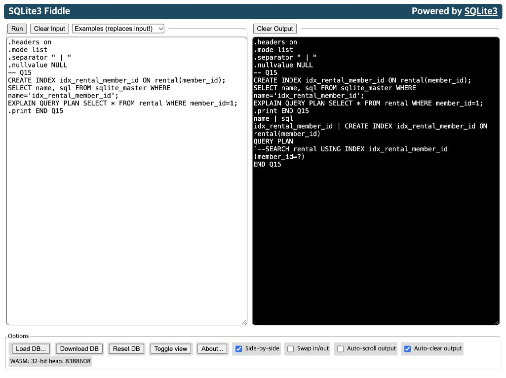
